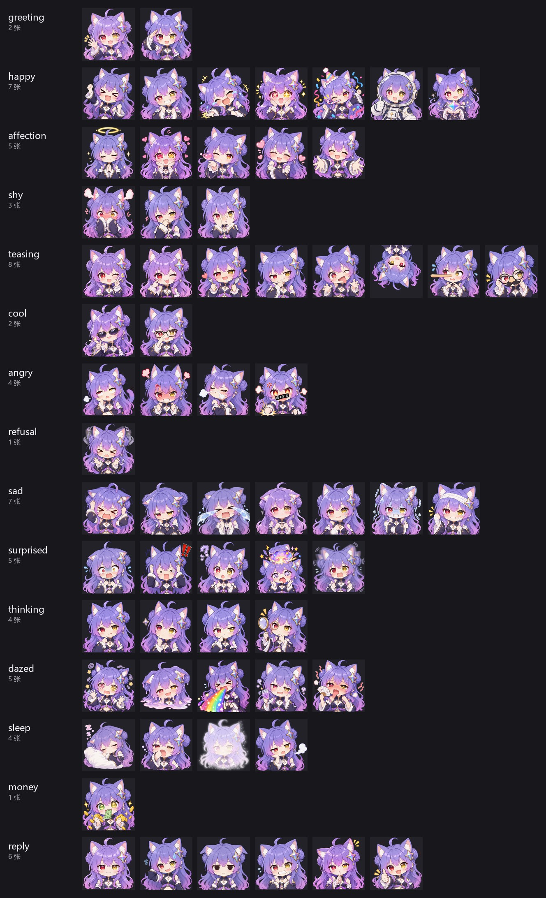

# 哈基米（AGY）表情包

适用于 [AstrBot 表情包管理器](https://github.com/anka-afk/astrbot_plugin_meme_manager) 的社区表情包，收录 64 张哈基米（Gemini / AGY）Q 版表情（86×86 PNG），按 15 个聊天语义类别整理。

## 安装

- 在表情包管理器的 **资源广场** 中选择「通过 GitHub 仓库安装」，填写 `Baizhi-Angelica/astrbot-meme-pack-agy`；
- 或克隆本仓库后按 [AstrBot 表情包管理器](https://github.com/anka-afk/astrbot_plugin_meme_manager) 说明导入。

安装后到 **设置中心 → 使用规则** 把本包加入默认、会话或人格规则，聊天时才会使用。

## 分类

| 分类 | 数量 | 适用场景 |
| --- | --- | --- |
| `greeting` | 2 | 用于打招呼、挥手问好、早安、收到任务或上线报到。 |
| `happy` | 7 | 用于开心、大笑、庆祝、撒花、星星眼、积极兴奋或展示高光时刻。 |
| `affection` | 5 | 用于喜欢、心动、比心、飞吻、贴贴、求抱抱或卖萌撒娇。 |
| `shy` | 3 | 用于害羞、脸红、捂嘴偷笑或从指缝暗中偷看。 |
| `teasing` | 8 | 用于调皮、眨眼、吐舌、坏笑、馋嘴、整活发癫、心虚或伪装玩梗。 |
| `cool` | 2 | 用于得意、装酷、戴墨镜拿捏或推眼镜学霸分析。 |
| `angry` | 4 | 用于生气、暴怒、傲娇喷气、翻白眼或吐槽输出；避免用于真实冲突。 |
| `refusal` | 1 | 用于摇头摆手拒绝、表示不行或达咩。 |
| `sad` | 7 | 用于难过、崩溃大哭、委屈求安慰、含泪微笑、失落、冷到结冰或负伤求救。 |
| `surprised` | 5 | 用于震惊、惊恐倒吸凉气、目瞪口呆、脑洞爆炸或剧烈抖动。 |
| `thinking` | 4 | 用于深度思考、纠结、挑眉怀疑或戴单片眼镜严谨考据。 |
| `dazed` | 5 | 用于晕头转向、融化躺平、微醺恍惚、热到融化或反胃吐槽。 |
| `sleep` | 4 | 用于困倦、打哈欠、休眠待机、晚安、长叹一口气或悄悄隐身溜走。 |
| `money` | 1 | 用于发财、见钱眼开、算力自由或金钱玩笑。 |
| `reply` | 6 | 用于普通回应、礼貌微笑、汗颜尴尬、面瘫无语、点头赞同或保密提醒。 |

## 来源与致谢

本项目基于原表情包项目整理适配为 AstrBot 表情包格式，原始出处及相关链接如下：

- **原表情包项目**：[Aster-Sirius-gemigemi/agy-meme](https://github.com/Aster-Sirius-gemigemi/agy-meme)
- **原项目 README 提及的相关来源**：
  - 功能灵感与架构参考：[yyh-001/dsh-meme](https://github.com/yyh-001/dsh-meme)
  - 内置哈基米表情包来源：[Bilibili (BV1F34G6BEVA)](https://www.bilibili.com/video/BV1F34G6BEVA)
  - 原项目提及的 Claude 表情包扩展来源：[Bilibili (BV1nuxQ6EEoN)](https://www.bilibili.com/video/BV1nuxQ6EEoN)
  - 哈基米（Gemini）人设原案：**zipzippipe**
- **AstrBot 表情包格式参考**：[liquidtoy001/astrbot-meme-pack-marisa](https://github.com/liquidtoy001/astrbot-meme-pack-marisa)

## 开源许可

由于哈基米（Gemini）原人设采用 **CC BY-NC-SA 4.0** 协议开源，本仓库亦遵循相同的 **[Creative Commons Attribution-NonCommercial-ShareAlike 4.0 International (CC BY-NC-SA 4.0)](https://creativecommons.org/licenses/by-nc-sa/4.0/deed.zh-hans)** 许可协议开源：

- **署名（BY）**：请保留原作者署名与上述来源链接；
- **非商业性使用（NC）**：仅限非商业用途，禁止用于商业目的；
- **相同方式共享（SA）**：若基于本素材进行再创作或分发，须采用相同许可协议。

完整协议文本详见 [LICENSE](LICENSE)。
